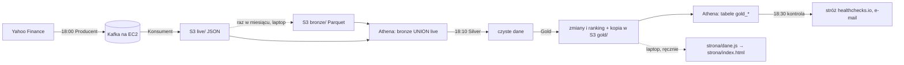

# GPW Pulse — dokumentacja etapu 1 (21.07–27.10.2026)

*Pisał Claude 28.10.2026, na prośbę Gracjana. Źródła: README, CLAUDE.md, przeglądy z 08.09, 08.10
i 23.10, 65 wpisów dziennika (21.07–27.10), historia gita (111 commitów). Liczby są ze stanu po biegu
27.10, ostatnim sprawdzonym. Bieg 28.10 nie był sprawdzany (od 28.10 kontrola co kilka dni i zawsze po
mailu stróża).*

**Zakres etapu 1:** od pierwszej sesji (21.07) do zamknięcia pierwszego etapu strony (27.10). Po nim
Gracjan zaczyna osobny kurs nauki (`../Nauka-DE`), a projekt chodzi sam, pod kontrolą co kilka dni.

---

## 1. Sedno

GPW Pulse to codzienny potok danych dla trzech spółek z GPW: Cyber_Folks (CBF), Synektik (SNT) i XTB.
Co wieczór o 18:00 czasu polskiego serwer w AWS pobiera kursy zamknięcia z Yahoo Finance, przepuszcza
je przez Kafkę do S3, Athena i pandas liczą z nich zmiany cen i ranking, a o 18:30 projekt sam
sprawdza, czy wszystko doszło, i przy awarii wysyła e-mail. Na koniec etapu 1 potok ma 802 sesje
historii na spółkę, od 12.09 nie zgubił żadnego wieczoru, a 130 cen porównanych z archiwum GPW zgadza
się co do grosza. Do tego jest strona na laptopie, która pokazuje dane z S3.

---

## 2. Co powstało

### Droga danych

### Części i ich stan

Stan według definicji „zrobione” z projektu: działa na prawdziwej drodze danych, ma sprawdzenie
z liczbą policzoną przed biegiem, awaria jest głośna, działa tam, gdzie ma działać, i jest opisane
zgodnie z prawdą. Przy każdej części niżej jest, czego brakuje.

| Część | Plik | Gdzie i kiedy | Co robi | Stan |
|---|---|---|---|---|
| Producent | `kod/data_ingestion.py`, `kod/session.py` | EC2, 18:00 | pobiera 3 lata notowań z Yahoo, przed 17:55 pomija dzisiejszą świecę, do Kafki wysyła tylko dzisiejszy dzień (z potwierdzeniem brokera), zaległe dni wstrzymuje i zgłasza | spełnia pięć warunków; ręczne nadrabianie `NADROB=1` na EC2 jeszcze nieuruchomione |
| Konsument | `kod/kafka_consumer.py` | EC2, 18:00 | czyta Kafkę, zapisuje plik JSON na spółkę do `live/`, dopiero potem przesuwa zakładkę | spełnia pięć warunków; `close()` poza `finally` (drobne) |
| Silver | `kod/silver.py` | EC2, 18:10 | zapytanie do Atheny `bronze UNION live`, typy, odsiew powtórzonych dni | spełnia pięć warunków; przy dwóch różnych cenach tego samego dnia wybiera przypadkowo |
| Gold | `kod/gold.py` | EC2, 18:10 | zmiana procentowa dzień do dnia, zmiana za cały okres, najbardziej zmienny pełny miesiąc; oba pliki do S3 | spełnia pięć warunków |
| Kontrola | `kod/control.py`, `kod/path.py` | EC2, 18:30 | dowód sukcesu w logu + cztery problemy z datami w Athenie, wynik do stróża | spełnia pięć warunków; nie wykryje złej ceny przy dobrej dacie, w święto daje fałszywy alarm |
| Kompakcja | `kod/compaction.py` | laptop, raz w miesiącu | przepisuje zakończone miesiące z `live/` do `bronze/` (Parquet), ze strażnikiem liczby wierszy | ręczna; pierwsza z kasowaniem na nowym strażniku — początek listopada |
| Wykresy | `kod/wykresy.py`, `kod/ranking.py` | laptop, na żądanie | ceny w czasie i ranking z Atheny | ręczne; obrazki w repozytorium ze stanem na 09.10 |
| Dane strony | `kod/data_stream.py` | laptop, ręcznie po 18:15 | pobiera pliki Golda z S3, sprawdza je, zapisuje `strona/dane.js` | pierwszy etap zamknięty 27.10 (pięć warunków dla laptopa) |
| Strona | `strona/index.html` | laptop, z dysku | notowania, wykresy z pełną historią, ranking, kalendarz, słownik, opis drogi danych | tylko na laptopie; internet to drugi etap |

**Narzędzia:** Python 3.14, pandas, `kafka-python`, `boto3`, `pyathena`, `matplotlib`, `pytest`;
Apache Kafka 4.3 (KRaft, usługa `systemd`) na EC2 `t3.micro` (Amazon Linux 2023, Elastic IP); S3, Glue,
Athena (`eu-north-1`); `cron` z `CRON_TZ=Europe/Warsaw`; healthchecks.io jako stróż; git i GitHub.

---

## 3. Liczby na koniec etapu (bieg 27.10)

| Co | Wartość | Skąd |
|---|---|---|
| Historia | 802 sesje na spółkę, 14.08.2023–27.10.2026, 2406 wierszy | `Kontrola: Dane 2406 wierszy`, Athena |
| Ciągłość | od 12.09 jeden blok w logu dziennie, bez dziury | log `companies/errors.txt`, sprawdzany przy każdej kontroli |
| Przewidywania | każdy bieg 10–27.10 zgodny co do liczby (start w logu, liczba linii, wiersze, zakładka Kafki, rozmiar pliku w S3, numer u stróża) | tabele przewidywań w CLAUDE.md |
| Ceny vs giełda | 130 cen z S3 porównanych z archiwum GPW, wszystkie zgodne co do grosza | README, „Stan — uczciwie” |
| Testy | 53 (`pytest kod/ -v`): 13 kontrola, 7 daty w Athenie, 18 granica sesji i podział dni, 15 dane strony | `kod/test_*.py` |
| Kod potoku | 12 skryptów, ok. 510 linii, testy ok. 245 linii | `wc -l kod/*.py` |
| Strona | `strona/index.html` 1626 linii (kod Claude'a), `dane.js` 27 965 B | `wc -l`, bieg 27.10 |
| Plik Golda w S3 | `dane_dzienne.csv` 161 161 B, `ranking.csv` 336 B | `aws s3 ls`, 27.10 |
| Ranking (zmiana za cały okres) | SNT +372,6%, XTB +267,7%, CBF +156,6% | Gold, 27.10 |
| Praca | 65 wpisów dziennika (dni z sesją), 111 commitów (lipiec 13, sierpień 25, wrzesień 53, październik 20), 48 plików w `notatki/plany/` | dziennik, `git log` |
| Koszt | kredyt AWS: 83,44 USD zostało 04.10; koniec darmowego planu 19.02.2027 | konsola AWS, CLAUDE.md |

---

## 4. Oś czasu

| Kiedy | Co się stało |
|---|---|
| 21–27.07 | Plan, git i GitHub; pierwsze dane programem (`requests` + Yahoo); 3 lata dla trzech spółek, zapis do plików (Bronze) |
| 31.07–06.08 | Silver i Gold w pandas: czyszczenie, łączenie, zmiany procentowe, ranking |
| 10–17.08 | Wykresy (`matplotlib`), Power BI, automatyzacja Harmonogramem Windows; utrata historii przy nadpisywaniu i naprawa; pierwsze testy `pytest` |
| 19–25.08 | Kafka (KRaft) na EC2 i decyzja: cały projekt do AWS. Producent, Konsument, historia w S3, Glue i Athena, Silver i Gold czytają z Atheny, stały adres serwera |
| 01–07.09 | `cron` na EC2; bieg przesunięty na po zamknięciu GPW; Silver i Gold na EC2; `bronze` w Parquecie i kompakcja |
| **08.09** | **Rachunek sumienia:** przegląd całości, pięć warunków „zrobione”, notatka „co może pójść źle” przed każdym mechanizmem, liczby przed każdym biegiem. Lista wad do naprawy po kolei |
| 12–17.09 | Strefa czasowa w `cron` (18:00 polskiego przez cały rok), ranking bez migotania, wynik Golda w S3 i w Athenie, zakładka Kafki dopiero po zapisie do S3 |
| 18–26.09 | Sygnał awarii: `control.py` szuka dowodu sukcesu, stróż healthchecks.io alarmuje także przy ciszy; od 26.09 kontrola sprawdza też daty w Athenie. Harmonogram Windows wyłączony, dane poza gitem |
| 03–09.10 | Pierwsza kompakcja z kasowaniem; Python 3.14 na EC2 (wyniki co do bajtu jak na 3.9); lista wad z 08.09 zamknięta; granica 17:55 w kodzie; drugi przegląd; strażnik kompakcji łapie tylko `404` |
| 08–23.10 | Yahoo przez tydzień podaje dla całej GPW stare zamknięcia. Naprawy: Producent wysyła tylko dzisiejszą świecę, zaległe wstrzymuje z alarmem, bez zapasowego adresu brokera (na EC2 od 20.10). Trzeci przegląd 23.10 |
| 10–27.10 | Strona: projekt partiami, od 19.10 nowy kierunek (zakładki, kod pisze Claude). Skrypt danych strony z testami, strona czyta `dane.js`, próbna awaria na prawdziwym biegu. **27.10 pierwszy etap strony zamknięty** |

---

## 5. Jak projekt pilnuje sam siebie

- **Producent zapisuje „wysłane” dopiero po potwierdzeniu brokera.** Martwy broker nie zjada dni.
- **Przed 17:55 dzisiejsza świeca jest pomijana**, bo Yahoo ma wtedy cenę z trwającej sesji.
- **Zaległe dni nie idą do Kafki same**, bo Yahoo potrafi mieć dla nich zamknięcie sprzed tygodnia.
  Zostają wstrzymane, kontrola daje alarm, a nadrobienie to ręczny bieg po porównaniu z GPW.
- **Konsument przesuwa zakładkę po zapisie do S3**, a Silver odsiewa powtórzone dni.
- **Kompakcja ma strażnika liczby wierszy** i kopię poprzedniego `bronze`, bo Athena potrafi bez
  błędu oddać pół tabeli.
- **Kontrola o 18:30 szuka dowodu sukcesu, a nie słowa „błąd”**, i sprawdza daty w Athenie. Stróż
  alarmuje też wtedy, gdy zgłoszenie nie przyjdzie.
- **Skrypt danych strony sprawdza pliki przed zapisem.** Przy problemie zostawia stary `dane.js` i kończy
  się kodem 1.
- **Liczby przed biegiem:** każdy bieg i każda zmiana mają przewidywanie zapisane wcześniej.

---

## 6. Co się zepsuło i czego to nauczyło

| Kiedy | Co | Wniosek |
|---|---|---|
| 13.08 | Yahoo daje okno „ostatnie 3 lata od dziś”, a skrypt nadpisywał plik, więc najstarsze dni znikały | scalać świeże dane z historią, nie nadpisywać |
| 26–31.08 | dni przepadały po cichu, bo „wysłane” zapisywało się przed potwierdzeniem | „zrobione” dopiero po potwierdzeniu |
| 01.09 | operacja gita na EC2 podmieniła pamięć Producenta, trzy lata poszły do Kafki drugi raz | stan maszyny nie należy do repozytorium |
| 02.09 | `live` zebrało całą historię zamiast świeżych dni | odsiew po dniu i spółce |
| 04.09 | Athena oddała 405 wierszy zamiast 2283, bez błędu | przed nadpisaniem porównać liczbę wierszy |
| do 08.09 | mechanizmy nazwane „ukończonymi” psuły się bez nadzoru | pięć warunków „zrobione”, przeglądy całości |
| 08.09 | Yahoo miało o 16:43 świecę z ceną sprzed zamknięcia | granica czasu w kodzie, ze strefą czasową |
| 17.09 | biblioteka Kafki zapisywała zakładkę przed zapisem do S3 | domyślne zachowanie biblioteki sprawdzać w jej kodzie |
| 08.10 | trzy jednakowe ceny w środku tygodnia | dziwną liczbę najpierw szukać w źródle (archiwum GPW) |
| 08.10 | strażnik kompakcji brał każdą odmowę S3 za „nową spółkę” | łapać tylko błąd, na który jest plan |

---

## 7. Zasady pracy, które powstały po drodze

- **Definicja „zrobione”** (08.09): pięć warunków naraz.
- **Notatka projektowa przed kodem**: co, po co, co może pójść źle, jak sprawdzimy, co zepsuje się
  za miesiąc. Kod dopiero po zatwierdzeniu.
- **Przewidywanie przed biegiem**: liczby zapisane, zanim padnie komenda, a potem porównane.
- **Przegląd całości** po każdym większym kawałku, z wynikiem w pliku. Były trzy: 08.09, 08.10, 23.10.
- **Najpierw naprawa, potem budowa**: żadnej nowej funkcji, dopóki lista wad nie jest zamknięta.
- **Kod projektu pisze Gracjan**, a Claude tłumaczy na innych danych. Wyjątek od 19.10: kod strony pisze
  Claude.
- **Ceny porównywane z archiwum GPW**, a nie z serwisami pośrednimi.

---

## 8. Umiejętności zdobyte w etapie 1

- **Python:** pętle, funkcje z typami, `try/except`, `logging`, `requests` i API, list comprehensions,
  `lambda`, strefy czasowe (`ZoneInfo`), `if __name__ == "__main__":`.
- **pandas:** `read_csv`, typy, `groupby`, `pct_change`, `agg`, `merge`, `pivot`, `drop_duplicates`,
  `to_parquet`, `read_sql` z `pyathena`.
- **SQL w Athenie:** `UNION`, `GROUP BY`, `HAVING`, `"$path"`; tabele zewnętrzne, partycje,
  `MSCK REPAIR`, `ALTER TABLE`.
- **Kafka:** producent z potwierdzeniem, konsument w grupie, zakładka i jej ręczny `commit`, KRaft,
  `systemd`.
- **AWS:** EC2, Elastic IP, S3 (`boto3`), IAM i role, Glue Crawler, Athena; koszt i kredyt.
- **Linux:** SSH, `cron` z `CRON_TZ`, `systemd`, zmienne środowiskowe, `venv`, `dnf`.
- **Jakość:** `pytest` z fixture i `tmp_path`, test prawdziwej drogi, zewnętrzny stróż, przewidywanie
  liczb.
- **git:** `mv`, `rm --cached`, `.gitignore`, praca z dwóch maszyn; lekcja z `git stash` z 01.09.

**Czego jeszcze brak** (cel kursu Nauka DE): klasy, dekoratory, generatory, testy z mockowaniem,
podzapytania i funkcje okna w SQL, modelowanie danych, Docker, Airflow, Spark, CI/CD.

---

## 9. Co zostaje otwarte

| Sprawa | Dlaczego ważne | Kiedy |
|---|---|---|
| Przegląd całości po etapie 1 strony | zasada 16, zapowiedziany 27.10 | do zrobienia |
| Kompakcja za październik | pierwsza z kasowaniem na nowym strażniku | początek listopada, z laptopa, nie między 17:55 a 18:35 |
| Zmiana Golda `117/111` → `120/114` | październik staje się pełnym miesiącem | 02.11 (przewidziane) |
| Fałszywy alarm w święto | kontrola nie zna kalendarza GPW | 11.11, potem `UP` 12.11 |
| `NADROB=1` nigdy nie chodził na EC2 | droga wyjścia z luki po wstrzymaniu | przy pierwszej potrzebie, po porównaniu z GPW |
| Luka po wstrzymaniu i jeden mail stróża | dzień nie wraca sam, a stróż milknie po pierwszym mailu | zasada: po mailu `DOWN` kontrola codziennie |
| Strona tylko na laptopie | drugi etap: internet, odświeżanie bez laptopa, warunki Yahoo | osobna notatka |
| Power BI | pokazuje dane do 20.09 | odłożone |
| Uprawnienia `AWSGlueConsoleFullAccess`, aktualizacja Amazon Linux | porządek i bezpieczeństwo | osobne decyzje |
| Koniec darmowego planu AWS | płatny plan, wyłączenie albo inna architektura | decyzja przed 19.02.2027 |

---

## 10. Możliwy etap 2 — do decyzji Gracjana

To lista kandydatów, a nie plan. Kolejność i zakres wybiera Gracjan.
- **Strona w internecie:** GitHub Pages, odświeżanie bez laptopa (np. GitHub Actions z kluczem tylko do
  odczytu `gold/`), sprawdzenie warunków Yahoo.
- **Drugi bieg Producenta tego samego wieczoru:** zmniejsza ryzyko spóźnionej świecy.
- **Nadrabianie z cenami z GPW** (`NADROB=gpw`, notatka i instrukcja leżą gotowe).
- **Kalendarz GPW w kontroli:** koniec fałszywych alarmów w święta.
- **Power BI na Athenę.**
- **Decyzja o AWS po 19.02.2027.**
- **Nowe umiejętności z kursu** (klasy, Docker, Airflow), np. orkiestracja potoku zamiast `cron`.

---

## 11. Gdzie szukać szczegółów

- [README](../../README.md) — opis projektu dla czytelnika z zewnątrz, „Stan — uczciwie”.
- [CLAUDE.md](../../CLAUDE.md) — zasady pracy, bieżący stan, codzienna kontrola, przewidywania.
- [Przegląd z 23.10](Przeglad-2026-10-23-calosc.md) — źródło prawdy o wadach; wcześniejsze:
  [08.10](Przeglad-2026-10-08-calosc.md), [08.09](Przeglad-2026-09-08-co-nie-gra.md).
- [Historia projektu](Historia-projektu.md) (dawny README do 14.09) i [historia stanu](Historia-stanu.md)
  (12.09–10.10).
- `notatki/dziennik/` — zapis każdej sesji (prywatny, poza gitem).
- [Słownik](../Slownik.md) — pojęcia prostym językiem.
